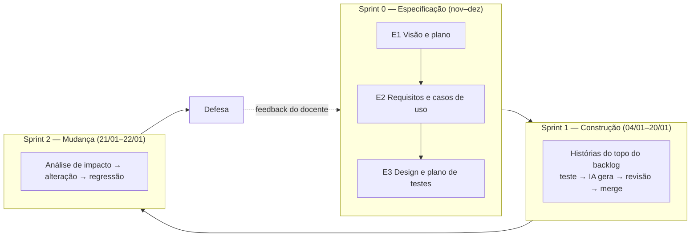
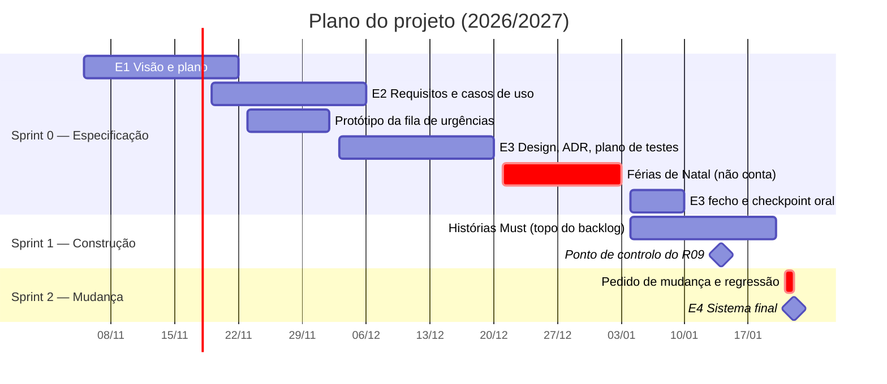
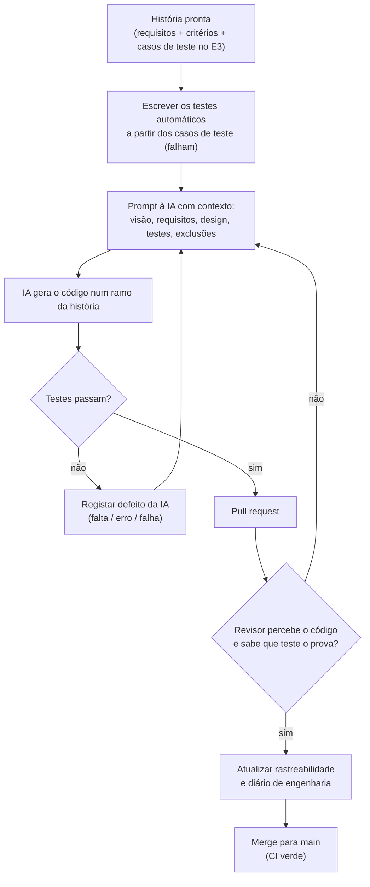

# Modelo de processo

> E1 · Parte 4. Que modelo de processo seguimos, porquê e comparado com que alternativas.
> Versão escrita com base nos modelos da sessão 3 (cascata, evolutivo, prototipagem, RAD, iterativo e incremental, espiral) e nas metodologias da sessão 4 (Scrum, XP, RUP). A rever se a sessão 4 (19/11) trouxer algo que mude a decisão.

## 1. O que no nosso contexto condiciona a escolha

Não existe um modelo "melhor": a escolha depende da estabilidade dos requisitos, do risco e da disponibilidade do cliente (sessão 3). Estes são os factos do **nosso** projeto que pesam na decisão:

| # | Facto do contexto | Consequência para o processo |
|---|-------------------|------------------------------|
| F1 | **Os testes são desenhados antes de o código ser gerado**, e uma funcionalidade só está concluída quando passa nesses testes (enunciado). | Antes de cada incremento de código tem de haver requisitos, critérios de aceitação e casos de teste. É preciso uma especificação inicial, mas não uma construção "tudo no fim". |
| F2 | **A IA é o programador.** Gera código em minutos, mas com defeitos: alucinações, limites mal tratados, funcionalidades a mais (riscos R01, R05, R06). | O ciclo **gerar → testar → rever** tem de ser curto e repetido muitas vezes. Um modelo que só testa no fim acumula defeitos da IA durante semanas. |
| F3 | **O pedido de mudança é certo**, não uma hipótese: chega na aula de 21/01 (turma A, quinta-feira) e o E4 fecha a 22/01: sobra 1 dia (risco R09). | O processo tem de aceitar mudança no fim sem refazer tudo: incrementos pequenos, rastreabilidade e testes de regressão automáticos. |
| F4 | **Requisitos parcialmente estáveis.** Agenda e ficha clínica são bem conhecidas; a regra de encaixe das urgências não está definida (risco R08). | A maior parte pode ser especificada à cabeça; a parte incerta precisa de clarificação, com um protótipo descartável. |
| F5 | **Entregas documentais com datas fixas** (E1 a 22/11, E2 a 06/12, E3 a 10/01), que valem 50% do projeto. | O processo tem de produzir documentação, não só código. Um modelo que sacrifica documentação perde metade da nota. |
| F6 | **Equipa de 4 alunos do regime pós-laboral (turma A), com aula à quinta-feira das 20h às 24h e tempo parcial**, sem experiência de gestão de risco formal. | O processo tem de ser leve: poucas cerimónias e poucos papéis, compatíveis com 1 a 2 encontros por semana. |
| F7 | **O "cliente" é o docente**, disponível uma vez por semana em aula. Não há utilizadores reais (rececionistas e veterinários são fictícios). | Feedback do cliente semanal, sim; workshops frequentes com utilizadores reais, não. |
| F8 | **Calendário partido**: 10 semanas de aulas, férias de 21/12 a 02/01 (não contam), e só cerca de 2,5 semanas de construção em janeiro. | A construção cabe em **dois sprints curtos**, como o enunciado prevê. |

## 2. Modelo escolhido

**Iterativo e incremental, organizado com Scrum, com uma fase inicial de especificação orientada a planos e práticas de XP na construção.**

Cada parte do modelo responde a um facto do contexto:

| Parte do modelo | Porquê (facto) |
|-----------------|----------------|
| **Sprint 0 de especificação, sequencial** (E1 → E2 → E3), cada entrega revista pelo docente antes da seguinte | F1 e F5: os testes têm de existir antes do código e a documentação é avaliada por fases. Aqui aproveitamos o que a cascata tem de bom: cada fase produz um documento aprovado que serve de entrada à seguinte. Neste projeto, esses documentos são também **o prompt** dado à IA. |
| **Construção iterativa e incremental em sprints com timebox** | F2 e F3: cada história é um incremento pequeno, testado e integrado. Quando chega o pedido de mudança, o sistema já está estável e coberto por testes. |
| **Scrum** como enquadramento (backlog priorizado, sprints, revisão e retrospetiva) | F6 e F8: dá estrutura com poucas cerimónias. O backlog priorizado permite cortar âmbito pelo fundo se faltar tempo (R11). |
| **Práticas de XP**: teste antes do código, revisão por pares (via pull request), integração contínua, pequenas entregas | F1 e F2: são as práticas que controlam os defeitos da IA (R01, R04, R06). Não usamos *pair programming* contínuo, que é incompatível com o horário (F6); a revisão obrigatória do pull request faz esse papel. |
| **Prototipagem descartável só para as urgências** | F4: só a regra das urgências está mal compreendida; um wireframe da fila de urgências serve para a fechar no E2 (R08). O protótipo não entra no produto. |
| **Revisão de riscos no início de cada sprint** (ideia da espiral) | Os riscos de IA mudam à medida que o código é gerado; o registo é revisto em cada sprint, mas sem a análise formal completa da espiral. |

## 3. Alternativas comparadas

### 3.1 Comparação pelos factos do contexto

✔ adequado · ~ parcialmente · ✘ inadequado

| Critério (facto) | **Escolhido**: iterativo-incremental + Scrum + XP | Cascata | Espiral | RAD | RUP |
|------------------|:---:|:---:|:---:|:---:|:---:|
| F1 Testes desenhados antes do código | ✔ | ✔ | ~ | ✘ | ✔ |
| F2 Ciclo curto gerar → testar → rever com IA | ✔ | ✘ | ~ | ✔ | ~ |
| F3 Mudança certa a 1 dia do fim | ✔ | ✘ | ✔ | ~ | ~ |
| F4 Uma parte dos requisitos incerta | ✔ | ✘ | ✔ | ✔ | ✔ |
| F5 Documentação avaliada por fases | ~ | ✔ | ✔ | ✘ | ✔ |
| F6 Equipa pequena, tempo parcial | ✔ | ✔ | ✘ | ~ | ✘ |
| F7 Cliente semanal, sem utilizadores reais | ✔ | ✔ | ✔ | ✘ | ✔ |
| F8 Dois sprints curtos em janeiro | ✔ | ~ | ✘ | ✔ | ~ |

### 3.2 Cascata (alternativa principal)

A cascata é a alternativa mais tentadora, porque o calendário das entregas (E1 → E2 → E3 → E4) **parece** uma cascata. Não a escolhemos por três razões do nosso contexto:

1. **O pedido de mudança no fim é certo (F3).** A cascata assume requisitos estáveis e trata a mudança tardia como cara. Aqui a mudança chega na véspera do prazo, por isso o processo tem de estar preparado para ela desde o início.
2. **Com IA, testar só no fim acumula defeitos (F2).** Se o código dos 3–5 casos de uso fosse gerado de uma vez e só depois testado, os defeitos da IA (limites, dependências inventadas, testes à medida) ficavam todos misturados. Integrando história a história, cada defeito aparece num diff pequeno e é fácil atribuí-lo e registá-lo.
3. **A regra das urgências não está definida (F4).** A cascata pede requisitos completos antes do design. Essa regra precisa de um ciclo de clarificação.

**O que aproveitamos da cascata:** a fase de especificação (sprint 0) é sequencial e cada documento é aprovado antes do seguinte. Faz sentido aí porque os requisitos da agenda e da ficha são estáveis e porque os documentos são avaliados por fases (F5).

### 3.3 Espiral

A espiral dá prioridade à análise de risco, e o nosso projeto tem riscos relevantes (ver [risks.md](risks.md)). Mas:

- foi pensada para projetos **longos, caros e de alto risco técnico**; o nosso é pequeno (3–5 casos de uso) e o risco técnico é baixo (aplicação de gestão sobre uma base de dados);
- cada volta exige protótipo e análise de risco formal, o que é demasiada estrutura para uma equipa a tempo parcial sem experiência nisso (F6);
- não há tempo para várias voltas em janeiro (F8).

**O que aproveitamos:** a revisão do registo de riscos no início de cada sprint.

### 3.4 RAD

O RAD tem um ciclo rápido de construção (F2), mas falha nos pontos mais importantes do nosso contexto:

- exige **utilizadores disponíveis para workshops (JAD)**; os nossos utilizadores são fictícios (F7);
- a pressa **prejudica a documentação e a qualidade**, e aqui a documentação vale 50% do projeto (F5) e os testes são o juiz (F1);
- o protótipo vai-se tornando o sistema, o que contraria a regra de desenhar os testes antes de gerar o código.

### 3.5 RUP

O RUP é a alternativa **mais próxima** do que fazemos. As suas fases encaixam no calendário: Conceção ≈ E1, Elaboração ≈ E2 + E3 (casos de uso e arquitetura), Construção ≈ sprint 1, Transição ≈ pedido de mudança e defesa. Também partilhamos dois princípios do RUP: ser **conduzido por casos de uso** (E2) e **centrado na arquitetura** (E3).

Não o adotamos completo porque o RUP define muitos papéis e artefactos, pensados para equipas maiores. Com 4 pessoas em regime pós-laboral (F6), manter esses artefactos tiraria tempo à especificação e aos testes, que são o que é avaliado. Ficamos com a estrutura de fases do RUP e usamos Scrum dentro da construção.

## 4. Calendário

| Período | Sprint | Objetivo | Saída |
|---------|--------|----------|-------|
| 05/11 – 22/11 | Sprint 0 | Visão, stakeholders, riscos, processo, backlog inicial | **E1** |
| 23/11 – 06/12 | Sprint 0 | Requisitos numerados com critérios de aceitação; 3–5 casos de uso; regra das urgências fechada | **E2** |
| 07/12 – 10/01 | Sprint 0 | Arquitetura, ADR, UML, plano de testes com valores-limite, Definition of Done, repositório pronto (projeto vazio + CI) | **E3** e checkpoint oral (07/01, turma A) |
| 04/01 – 20/01 | **Sprint 1** | Implementar as histórias *Must*, cada uma com os testes do E3 a passar | Incremento estável **antes** da sessão 11 |
| 21/01 – 22/01 | **Sprint 2** | Responder ao pedido de mudança: análise de impacto, alteração, rastreabilidade, regressão | **E4** |

Nota: o sprint 1 começa a 04/01, antes do prazo formal do E3 (10/01), porque os casos de teste das primeiras histórias ficam desenhados em dezembro. Uma história só entra no sprint 1 depois de os seus casos de teste estarem escritos (Definition of Ready).

## 5. Papéis

A equipa tem 4 elementos, um por papel. **Todos** são também *developers*: escrevem prompts, revêem código, escrevem testes e documentação, e fazem os seus próprios commits.

| Papel | Sigla | Responsabilidades | Elemento |
|-------|-------|-------------------|----------|
| Product Owner | PO | Ordena o backlog; fecha as regras de negócio com o docente; dono dos riscos de âmbito e de requisitos (R03, R05, R08). | Diogo Consciência |
| Scrum Master | SM | Conduz o planeamento, os pontos de situação e as retrospetivas; remove bloqueios; dono dos riscos de calendário e de equipa (R04, R09, R10, R11). | Wilson Amorim |
| Responsável de testes e qualidade | RT | Garante que os testes correspondem ao plano de testes do E3; mantém o registo de defeitos da IA (R01, R06, R07). | Miguel Cruz |
| Responsável do repositório e da integração contínua | RR | Regras de ramos e pull requests, pipeline de CI, verificação de dependências e da distribuição de commits (R02, R12, R13). | André Fernandes |

## 6. Como funciona o Scrum neste projeto

| Elemento Scrum | Como o adaptamos | Porquê |
|----------------|------------------|--------|
| **Product backlog** | [backlog.md](backlog.md) (versão de referência) e issues do GitHub (trabalho do dia a dia). | O backlog em Markdown é dado à IA como contexto. |
| **Sprint backlog** | Quadro do GitHub Projects: *A fazer → Em curso → Em revisão → Feito*. | Visível para todos e para o docente. |
| **Sprint planning** | No início de cada sprint, depois da aula de quinta-feira (turma A). | A aula já junta toda a equipa. |
| **Daily scrum** | Substituída por **dois pontos de situação por semana**, assíncronos, no canal da equipa: o que fiz, o que vou fazer, o que me bloqueia. | Uma reunião diária é inviável para quem tem aulas às 20h e outras ocupações durante o dia (F6). |
| **Sprint review** | Fim do sprint 1: demonstração interna dos casos de uso e dos testes a passar. Fim do sprint 2: a defesa. | Os utilizadores são fictícios; o docente é o cliente (F7). |
| **Retrospetiva** | 20 minutos depois de cada entrega (E1, E2, E3, E4): o que mudar no processo e nos prompts. | As lições sobre como usar a IA mudam o processo seguinte. |
| **Incremento** | O ramo `main`, sempre com todos os testes a passar. | Testes como juiz (F1). |

## 7. O ciclo de cada história na construção

Este ciclo aplica os princípios do enunciado: os artefactos são o prompt, os testes são o juiz e o grupo responde por tudo.

## 8. Definition of Ready e Definition of Done (rascunho)

A versão final da Definition of Done é entregue no E3.

**Definition of Ready** — uma história só entra num sprint se:

- tiver requisitos numerados com critérios de aceitação verificáveis (E2);
- tiver casos de teste desenhados com partições de equivalência e valores-limite (E3);
- não tiver dependências por resolver de outra história.

**Definition of Done** — uma história só está feita se:

- [ ] os testes automáticos que implementam os casos de teste do E3 passam, localmente e na integração contínua;
- [ ] os testes foram escritos antes do código de produção (commit anterior) e não foram alterados para "caber" no código;
- [ ] o pull request foi revisto e aprovado por **outro** elemento, que sabe explicar o código e o teste que o prova;
- [ ] a matriz de rastreabilidade liga requisito → design → teste → código;
- [ ] não há dados pessoais reais, segredos ou pacotes não verificados;
- [ ] os defeitos da IA encontrados estão registados, e as interações relevantes estão no diário de engenharia;
- [ ] o código não acrescenta funcionalidades fora da história.
