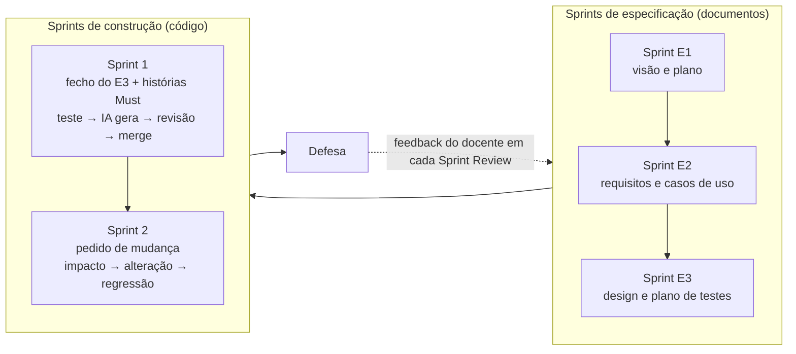
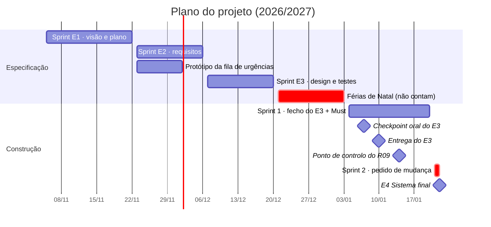
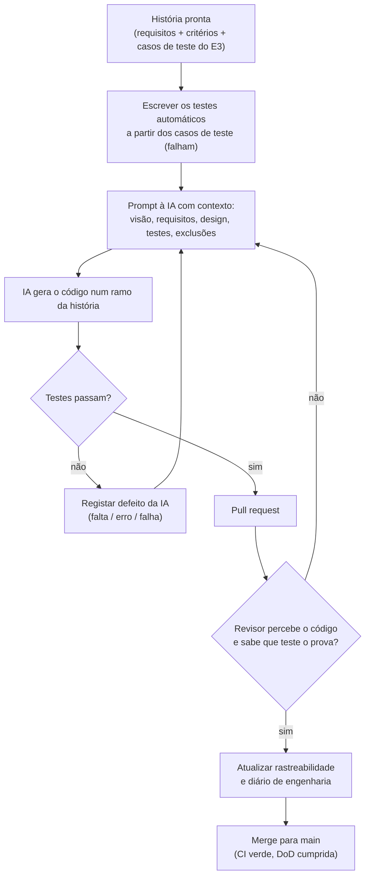

# Modelo de processo

> E1 · Parte 4. Que modelo de processo seguimos, porquê e comparado com que alternativas.
> Baseado nos modelos da sessão 3 (cascata, evolutivo, prototipagem, RAD, iterativo e incremental, espiral) e nas metodologias da sessão 4 (Manifesto Ágil, Scrum segundo o Scrum Guide 2020, XP e RUP).

## 1. O que no nosso contexto condiciona a escolha

Nenhum modelo é melhor por si só: a escolha depende da adequação ao projeto (sessão 4). Estes são os factos do **nosso** projeto que pesam na decisão:

| # | Facto do contexto | Consequência para o processo |
|---|-------------------|------------------------------|
| F1 | **Os testes são desenhados antes de o código ser gerado**, e uma funcionalidade só está concluída quando passa nesses testes (enunciado). | Antes de cada incremento de código tem de haver requisitos, critérios de aceitação e casos de teste. É preciso especificar primeiro, mas não construir tudo de uma vez no fim. |
| F2 | **A IA é o programador.** Gera código em minutos, mas com defeitos: alucinações, limites mal tratados, funcionalidades a mais (riscos R01, R05, R06). | O ciclo **gerar → testar → rever** tem de ser curto e repetido muitas vezes. Um modelo que só testa no fim acumula defeitos da IA durante semanas. |
| F3 | **O pedido de mudança é certo**, não uma hipótese: chega na aula de 21/01 (turma A, sessão 11) e o E4 fecha a 22/01. Sobra 1 dia (risco R09). | O processo tem de aceitar mudança no fim sem refazer tudo: incrementos pequenos, rastreabilidade e testes de regressão automáticos. |
| F4 | **Requisitos parcialmente estáveis.** A agenda e a ficha clínica são bem conhecidas; a regra de encaixe das urgências não está definida (risco R08). | A maior parte pode ser especificada à cabeça; a parte incerta precisa de clarificação, com um protótipo descartável. |
| F5 | **Entregas documentais com datas fixas** (E1 a 22/11, E2 a 06/12, E3 a 10/01), que valem 50% do projeto. | O processo tem de produzir documentação, não só código. Um modelo que sacrifica a documentação perde metade da nota. |
| F6 | **Equipa de 4 alunos do regime pós-laboral (turma A)**, com aula à quinta-feira das 20h00 às 24h00 e tempo parcial, sem experiência de gestão de risco formal. | O processo tem de ser leve: poucos eventos e poucas responsabilidades, compatíveis com o horário. |
| F7 | **O "cliente" é o docente**, disponível uma vez por semana em aula. Não há utilizadores reais (rececionistas e veterinários são fictícios). | Feedback do cliente semanal, sim; workshops frequentes com utilizadores reais, não. |
| F8 | **Calendário partido**: férias de 21/12 a 02/01 (não contam como tempo de projeto) e só cerca de 2,5 semanas de construção em janeiro. | A construção cabe em **dois sprints curtos**, como o enunciado prevê. |

## 2. Modelo escolhido

**Scrum como framework de gestão, num ciclo iterativo e incremental, com as práticas técnicas do XP na construção.** Os três primeiros sprints produzem a especificação (E1, E2, E3); os dois últimos produzem o código (sprint 1) e a resposta à mudança (sprint 2).

Cada parte do modelo responde a um facto do contexto:

| Parte do modelo | Porquê (facto) |
|-----------------|----------------|
| **Sprints de especificação, um por entrega**, cada um revisto pelo docente antes do seguinte | F1 e F5: os testes têm de existir antes do código e a documentação é avaliada por fases. Cada sprint produz um documento revisto que serve de entrada ao seguinte. Neste projeto, esses documentos são também **o prompt** dado à IA. |
| **Sprints de construção com timebox curto** | F2 e F3: cada história é um incremento pequeno, testado e integrado. Quando chega o pedido de mudança, o sistema já está estável e coberto por testes. |
| **Scrum** como enquadramento: Product Backlog ordenado, Sprint Goal, eventos com timebox e Definition of Done | F6 e F8: dá estrutura com poucos eventos. O backlog ordenado permite cortar âmbito pelo fundo se faltar tempo (R11). |
| **Práticas do XP**: testes primeiro, integração contínua, pequenas entregas, desenho simples, revisão por pares | F1 e F2: são as práticas que controlam os defeitos da IA (R01, R04, R06). |
| **Prototipagem descartável só para as urgências** | F4: só a regra das urgências está mal compreendida; um wireframe da fila de urgências serve para a fechar no E2 (R08). O protótipo não entra no produto. |
| **Revisão do registo de riscos no Sprint Planning** (ideia da espiral) | Os riscos de IA mudam à medida que o código é gerado; o registo é revisto em cada sprint, sem a análise formal completa da espiral. |

### 2.1 Porque é ágil, e onde não é

Ligamos a escolha aos valores e princípios do Manifesto Ágil (sessão 4), sem os tratar como exclusões:

| Valor ou princípio | Como aparece no nosso processo |
|--------------------|--------------------------------|
| **Responder à mudança** mais do que seguir um plano; **princípio 2** (aceitar alterações de requisitos mesmo numa fase tardia) | O pedido de mudança de 21/01 é tratado como um sprint próprio (sprint 2), preparado desde o início pela rastreabilidade e pelos testes de regressão (F3). |
| **Software funcional** mais do que documentação abrangente | Aqui a documentação vale 50% da nota e é o prompt da IA (F5), por isso documentamos mais do que uma equipa ágil típica. Documentamos **só o que é útil**: o que a IA precisa como contexto e o que o docente avalia. |
| **Colaboração com o cliente**; **princípio 4** (cliente e equipa trabalham juntos) | O docente faz de cliente e valida cada entrega em aula (Sprint Review). Não está disponível diariamente (F7), o que é uma limitação assumida. |
| **Princípio 9** (excelência técnica) e **princípio 10** (simplicidade) | Testes antes do código e desenho simples contrariam o código excessivo que a IA tende a gerar (sessão 4, "Agile na era da IA"). |
| **Princípio 12** (refletir regularmente) | Sprint Retrospective depois de cada entrega, para ajustar o processo e os prompts. |

## 3. Como aplicamos o Scrum

Seguimos o **Scrum Guide 2020** (a versão em vigor): Scrum Team de 10 pessoas ou menos, Developers autogeridos, *responsabilidades* em vez de papéis, e três artefactos, cada um com o seu compromisso.

### 3.1 Artefactos e compromissos

| Artefacto | Compromisso | Onde está |
|-----------|-------------|-----------|
| **Product Backlog** | **Product Goal**: o objetivo de longo prazo do produto | [backlog.md](backlog.md) (versão de referência, dada à IA como contexto) e issues do GitHub (trabalho do dia a dia) |
| **Sprint Backlog** | **Sprint Goal**: o único objetivo do sprint (ver o calendário, secção 6) | Quadro do GitHub Projects: *A fazer → Em curso → Em revisão → Feito* |
| **Incremento** | **Definition of Done**: a qualidade exigida | [dod.md](dod.md). No código, o incremento é o ramo `main`, sempre com todos os testes a passar. |

### 3.2 Eventos

| Evento | Como o adaptamos | Porquê |
|--------|------------------|--------|
| **Sprint** | De 2 dias (sprint 2) a 3 semanas de tempo de projeto, sempre menos de 1 mês. Um sprint por entrega e dois de construção, como o enunciado prevê. | O guia pede 1 mês ou menos; as entregas dão o ritmo (F5, F8). |
| **Sprint Planning** | Depois da aula de quinta-feira em que o sprint começa: Porquê (Sprint Goal), O quê (itens do topo do backlog), Como (tarefas de 1 dia ou menos). Inclui rever o registo de riscos. Máximo de 1 hora. | A aula já junta toda a equipa. |
| **Daily Scrum** | **Nos sprints de construção**: mensagem diária assíncrona no canal da equipa, no formato que os Developers escolheram: o que fiz, o que vou fazer, o que me bloqueia. **Nos sprints de especificação**: dois pontos de situação por semana, no mesmo formato. | Uma reunião presencial diária é inviável para quem tem aulas às 20h00 e trabalha durante o dia (F6). Nos sprints de construção o ritmo é mais intenso e o prazo mais curto (F3, F8), por isso a sincronização passa a diária. |
| **Sprint Review** | Sprints de especificação: a entrega no repositório e o feedback do docente na aula seguinte, que ajusta o backlog. Sprint 1: demonstração interna dos casos de uso com os testes a passar. Sprint 2: a defesa. | O docente é o cliente (F7). O que se mostra é trabalho feito, não slides. |
| **Sprint Retrospective** | 20 minutos depois de cada entrega: o que correu bem, o que melhorar e que ações concretas aplicamos, incluindo na DoD e na forma de usar a IA. | As lições sobre como usar a IA mudam o sprint seguinte. |

### 3.3 Variáveis de controlo (XP)

Das quatro variáveis do XP, **tempo** (prazos fixos do enunciado) e **custo** (4 pessoas a tempo parcial) não mudam. A **qualidade** não é moeda de troca: está fixada na [Definition of Done](dod.md). A variável que ajustamos é o **âmbito**: se faltar tempo, cortamos histórias pelo fundo do backlog (*Could*, depois *Should*), nunca pelo topo.

### 3.4 Pilares e valores

O Scrum assenta no **empirismo**: as decisões tomam-se com base no que se observa. Os três pilares têm, no nosso projeto, um sítio concreto onde acontecem:

| Pilar | Onde acontece no nosso projeto |
|-------|--------------------------------|
| **Transparência** | Tudo está no repositório e é visível para a equipa e para o docente: documentos em `docs/`, backlog em Markdown, quadro do GitHub Projects, pull requests com a revisão escrita, histórico de commits de cada elemento. A [Definition of Done](dod.md) torna explícito o que quer dizer "feito". |
| **Inspeção** | A revisão de cada pull request por outro elemento; a integração contínua, que corre os testes em cada pull request; a Sprint Review com o docente em cada entrega; a revisão do registo de riscos no Sprint Planning. |
| **Adaptação** | O PO reordena o backlog depois do feedback do docente; a Sprint Retrospective muda a DoD e a forma de usar a IA; quando um teste falha, o código gerado é corrigido antes de entrar em `main`; o pedido de mudança é absorvido no sprint 2. |

Os cinco valores traduzem-se em compromissos de equipa concretos:

| Valor | O que significa para nós |
|-------|--------------------------|
| **Compromisso** | Cada elemento cumpre as tarefas que escolheu no Sprint Planning e faz os seus próprios commits; se não conseguir, avisa no ponto de situação, não no dia da entrega. |
| **Foco** | Só se trabalha em histórias do sprint corrente; o que a IA propõe fora delas não entra (risco R05). |
| **Abertura** | Os defeitos da IA e os erros próprios são registados, não escondidos; o uso de IA é declarado no README. |
| **Respeito** | A revisão de um pull request critica o código, não a pessoa; as decisões do PO sobre o backlog são respeitadas mesmo quando um Developer discorda. |
| **Coragem** | Rejeitar código gerado que passa nos testes mas que ninguém percebe (risco R04); dizer ao docente cedo que a regra das urgências não está fechada (risco R08). |

## 4. Práticas do XP na construção

| Prática do XP | Como a usamos | Risco que controla |
|---------------|---------------|--------------------|
| **Testes primeiro (TDD)** | Os testes automáticos são escritos a partir dos casos de teste do E3 e entram num commit **antes** do código de produção. | R01, R06 |
| **Programação em par** | Na forma "par humano–IA" da sessão 4: a IA escreve, a pessoa navega, revê e decide. Em vez de *pair programming* contínuo entre pessoas (incompatível com o horário, F6), há **revisão obrigatória do pull request por outro elemento**. | R04 |
| **Integração contínua** | GitHub Actions compila e corre os testes em cada pull request. | R02, R09 |
| **Releases pequenas** | Uma história por ramo e por pull request. | R13 |
| **Desenho simples e refactoring** | Só se gera o que a história pede; o refactoring é feito com os testes a passar. | R05 |
| **Padrões de codificação** | Ficheiro de contexto para a IA com stack, versões e regras (por exemplo, `TimeProvider` em vez de `DateTime.Now`). | R02, R07 |
| **Propriedade coletiva** | Qualquer elemento pode alterar qualquer código, desde que passe por pull request; os pares autor/revisor rodam. | R04, R11 |

## 5. Responsabilidades na Scrum Team

A Scrum Team tem as três responsabilidades do Scrum Guide 2020: **Product Owner**, **Scrum Master** e **Developers**. **Os quatro elementos são Developers**: escrevem prompts, revêem código, escrevem testes e documentação, e fazem os seus próprios commits.

| Responsabilidade (Scrum) | Elemento | O que faz neste projeto |
|--------------------------|----------|-------------------------|
| **Product Owner** | Diogo Consciência | Define e comunica o Product Goal; ordena o backlog; decide o que entra no sprint; fecha as regras de negócio com o docente. Dono dos riscos de âmbito e de requisitos (R03, R05, R08). |
| **Scrum Master** | Wilson Amorim | Garante que os eventos acontecem e respeitam o timebox; remove impedimentos; conduz as retrospetivas. Dono dos riscos de calendário e de equipa (R04, R09, R10, R11). |
| **Developers** | Os quatro elementos | Criam o Sprint Backlog, cumprem a Definition of Done e adaptam o plano todos os dias rumo ao Sprint Goal. |

Dentro dos Developers, dividimos também duas **responsabilidades adicionais**. Não são papéis do Scrum nem criam sub-equipas ou hierarquia: só garantem que cada tarefa tem alguém que responde por ela.

| Responsabilidade adicional | Sigla | Elemento | O que faz |
|----------------------------|-------|----------|-----------|
| Testes e qualidade | RT | Miguel Cruz | Garante que os testes correspondem ao plano de testes do E3 e que a DoD é cumprida; mantém o registo de defeitos da IA. Dono de R01, R06 e R07. |
| Repositório e integração contínua | RR | André Fernandes | Regras de ramos e pull requests, pipeline de CI, verificação de dependências e da distribuição de commits. Dono de R02, R12 e R13. |

## 6. Calendário

| Sprint | Período | Sprint Goal | Saída |
|--------|---------|-------------|-------|
| **E1** | 05/11 – 22/11 | Ter a visão, os stakeholders, os riscos, o processo, o backlog e a DoD aprovados pela equipa, para servirem de base aos requisitos. | **E1** |
| **E2** | 23/11 – 06/12 | Transformar o topo do backlog em requisitos numerados e verificáveis e escolher os 3 a 5 casos de uso, com a regra das urgências fechada. | **E2** |
| **E3** | 07/12 – 20/12 | Desenhar a arquitetura, as ADR, os diagramas UML e os casos de teste com valores-limite das histórias *Must*. | Rascunho completo do E3 |
| **1** | 04/01 – 20/01 | Fechar o E3 (repositório pronto, CI, DoD final, checkpoint oral a 07/01, entrega a 10/01) e implementar as histórias *Must*, cada uma com os testes do E3 a passar, **antes** da sessão 11. | E3 e incremento estável |
| **2** | 21/01 – 22/01 | Responder ao pedido de mudança sem regressões: análise de impacto, alteração, rastreabilidade e testes de regressão. | **E4** |

Nenhum sprint passa de 1 mês. O E3 fica dividido entre o sprint E3, que acaba antes das férias, e o início do sprint 1: o enunciado põe o sprint 1 a começar a 04/01 e o prazo do E3 a 10/01, por isso os primeiros dias do sprint 1 fecham o E3. As histórias só entram no sprint 1 depois de os seus casos de teste estarem escritos (Definition of Ready).

## 7. O ciclo de cada história na construção

Este ciclo aplica os três princípios do enunciado: os artefactos são o prompt, os testes são o juiz e o grupo responde por tudo.

## 8. Definition of Ready

Uma história só entra num sprint de construção se:

- tiver requisitos numerados com critérios de aceitação verificáveis (E2);
- tiver casos de teste desenhados com partições de equivalência e valores-limite (E3);
- couber num sprint (tamanho P ou M; uma história G tem de ser partida, ver [backlog.md](backlog.md));
- não tiver dependências por resolver de outra história.

Uma história só está **feita** quando cumpre a [Definition of Done](dod.md).

## 9. Alternativas comparadas

### 9.1 Comparação pelos factos do contexto

✔ adequado · ~ parcialmente · ✘ inadequado

| Critério (facto) | **Escolhido**: Scrum + XP, iterativo e incremental | Cascata | Espiral | RAD | RUP |
|------------------|:---:|:---:|:---:|:---:|:---:|
| F1 Testes desenhados antes do código | ✔ | ✔ | ~ | ✘ | ✔ |
| F2 Ciclo curto gerar → testar → rever com IA | ✔ | ✘ | ~ | ✔ | ~ |
| F3 Mudança certa a 1 dia do fim | ✔ | ✘ | ✔ | ~ | ~ |
| F4 Uma parte dos requisitos incerta | ✔ | ✘ | ✔ | ✔ | ✔ |
| F5 Documentação avaliada por fases | ~ | ✔ | ✔ | ✘ | ✔ |
| F6 Equipa pequena, tempo parcial | ✔ | ✔ | ✘ | ~ | ✘ |
| F7 Cliente semanal, sem utilizadores reais | ✔ | ✔ | ✔ | ✘ | ✔ |
| F8 Dois sprints curtos em janeiro | ✔ | ~ | ✘ | ✔ | ~ |

O único ponto parcial do modelo escolhido é o F5: o Scrum não exige documentação por fases. Resolvemos isso com um sprint por entrega, em que o documento é o incremento.

### 9.2 Cascata (alternativa principal)

A cascata é a alternativa mais tentadora, porque o calendário das entregas (E1 → E2 → E3 → E4) **parece** uma cascata. Não a escolhemos por três razões do nosso contexto:

1. **O pedido de mudança no fim é certo (F3).** A cascata assume requisitos estáveis e trata a mudança tardia como cara; o feedback só chega no fim. Aqui a mudança chega na véspera do prazo, por isso o processo tem de estar preparado para ela desde o início.
2. **Com IA, testar só no fim acumula defeitos (F2).** Se o código dos 3–5 casos de uso fosse gerado de uma vez e só depois testado, os defeitos da IA (limites, dependências inventadas, testes à medida) ficavam todos misturados. Integrando história a história, cada defeito aparece num diff pequeno e é fácil atribuí-lo e registá-lo.
3. **A regra das urgências não está definida (F4).** A cascata pede requisitos completos antes do design. Essa regra precisa de um ciclo de clarificação.

**O que aproveitamos da cascata:** os sprints de especificação seguem uma ordem fixa (E1 → E2 → E3) e cada documento é revisto antes do seguinte. Faz sentido aí porque os requisitos da agenda e da ficha são estáveis e porque os documentos são avaliados por fases (F5).

### 9.3 Espiral

A espiral dá prioridade à análise de risco, e o nosso projeto tem riscos relevantes (ver [riscos.md](riscos.md)). Mas:

- é indicada para projetos **longos ou de alto risco** (defesa, sistemas críticos) e é mais cara e complexa; o nosso é pequeno (3–5 casos de uso) e o risco técnico é baixo (aplicação de gestão sobre uma base de dados);
- cada volta exige protótipo e análise de risco formal, o que é demasiada estrutura para uma equipa a tempo parcial sem experiência nisso (F6);
- não há tempo para várias voltas em janeiro (F8).

**O que aproveitamos:** a revisão do registo de riscos no início de cada sprint.

### 9.4 RAD

O RAD tem um ciclo rápido de construção (F2), mas falha nos pontos mais importantes do nosso contexto:

- exige **utilizadores disponíveis para workshops**; os nossos utilizadores são fictícios (F7);
- a pressa **prejudica a documentação e a qualidade**, e aqui a documentação vale 50% do projeto (F5) e os testes são o juiz (F1);
- o protótipo vai-se tornando o sistema, o que contraria a regra de desenhar os testes antes de gerar o código.

### 9.5 RUP

O RUP é a alternativa **mais próxima** do que fazemos, mas **não é ágil**: é um processo híbrido, iterativo e disciplinado. As suas quatro fases encaixam no calendário, com os marcos a coincidir com as entregas:

| Fase do RUP | Marco | No nosso calendário |
|-------------|-------|---------------------|
| Conceção | Objetivos do ciclo de vida | E1 |
| Elaboração | Arquitetura do ciclo de vida | E2 + E3 (casos de uso e arquitetura) |
| Construção | Capacidade operacional inicial | Sprint 1 |
| Transição | Lançamento do produto | Sprint 2 e defesa |

Também partilhamos dois princípios do RUP: ser **guiado por casos de uso** (E2) e **centrado na arquitetura** (E3).

Não o adotamos porque o RUP define muitos papéis formais, nove disciplinas e muita documentação, pensados para projetos grandes e complexos com equipas grandes. Com 4 pessoas em regime pós-laboral (F6), manter esses artefactos tiraria tempo à especificação e aos testes, que são o que é avaliado. Também não seria a melhor resposta ao F3: o RUP controla as alterações, mas com mais formalidade do que um sprint curto dedicado à mudança.
