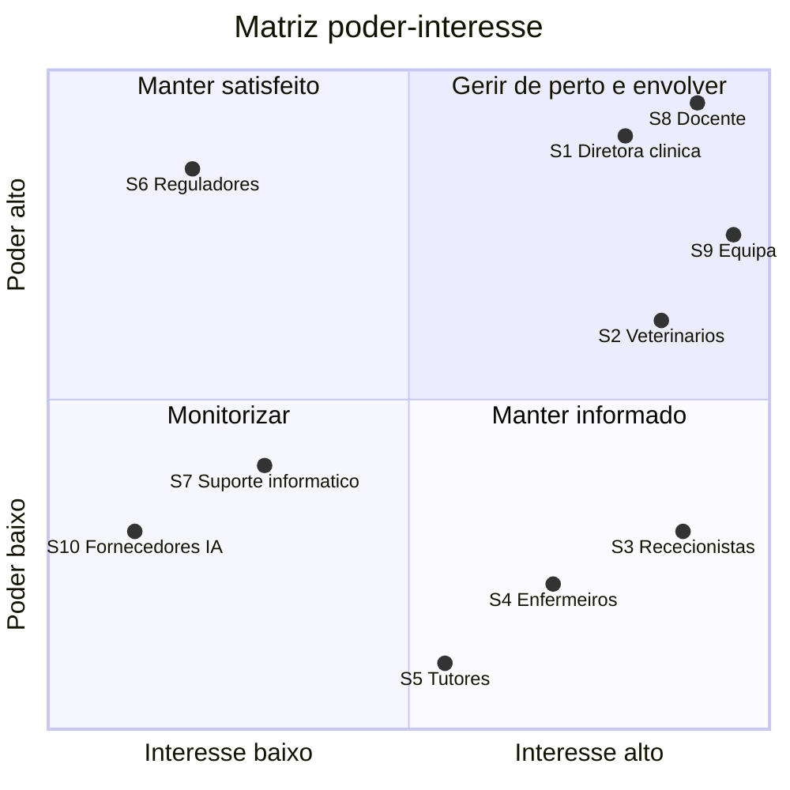

# Análise de stakeholders

> E1 · Parte 2. Os stakeholders da clínica são fictícios, mas plausíveis para o domínio (ver o contexto em [vision.md](vision.md)).
> Seguimos as cinco etapas da sessão 3: identificar, classificar, posicionar na matriz poder-interesse, perceber necessidades e conflitos, e definir a comunicação.

## 1. Identificação

Pergunta-guia: *quem usa, paga, gere, mantém ou é afetado pelo sistema?*
Há dois grupos de stakeholders: os do **domínio** (a clínica) e os do **projeto** (quem decide e avalia o trabalho).

| ID | Stakeholder | Categoria | Usa | Paga / decide | Gere | Mantém | É afetado |
|----|-------------|-----------|:---:|:---:|:---:|:---:|:---:|
| S1 | Diretora clínica (sócia-gerente da clínica) | Cliente | ● | ● | ● | | ● |
| S2 | Médicos veterinários (3) | Utilizadores finais | ● | | | | ● |
| S3 | Rececionistas (2) | Utilizadores finais | ● | | | | ● |
| S4 | Enfermeiros veterinários (2) | Utilizadores finais | ● | | | | ● |
| S5 | Tutores dos animais | Afetados (externos) | | | | | ● |
| S6 | Entidades reguladoras: ordem profissional dos médicos veterinários e autoridade de proteção de dados | Stakeholders externos | | | | | |
| S7 | Empresa de suporte informático da clínica (fictícia) | Responsáveis de manutenção | | | | ● | ● |
| S8 | Docente da UC: faz de cliente na validação dos requisitos e avalia o projeto | Cliente do projeto / avaliador | | ● | | | |
| S9 | Equipa de desenvolvimento (o grupo, 4 elementos) | Equipa de desenvolvimento | | | ● | ● | ● |
| S10 | Fornecedores das ferramentas de IA usadas para gerar código | Fornecedores externos | | | | | |

## 2. Classificação

Critérios da sessão 3: **posição** (interno/externo), **influência** (alta/média/baixa), **interesse** (direto: impacto operacional; indireto: impacto estratégico) e **função** (técnica/negócio/legal/suporte).

| ID | Stakeholder | Posição | Influência | Interesse | Função | Interesse principal no sistema |
|----|-------------|---------|------------|-----------|--------|--------------------------------|
| S1 | Diretora clínica | Interno | **Alta** | Direto e indireto | Negócio | Ocupação da agenda; registos clínicos fiáveis perante uma reclamação ou inspeção; menos reclamações de tutores. |
| S2 | Médicos veterinários | Interno | **Média** | Direto | Negócio (clínica) | Ver o histórico completo antes da consulta; registar a nota depressa; não ter consultas sobrepostas; poder atender urgências sem desorganizar o dia. |
| S3 | Rececionistas | Interno | Baixa | Direto | Suporte | Marcar ao telefone em poucos passos; ver logo quem está livre; não ter de decidir sozinhas onde encaixar uma urgência. |
| S4 | Enfermeiros veterinários | Interno | Baixa | Direto | Negócio (clínica) | Classificar a urgência e passá-la ao veterinário certo; ver alergias e medicação do animal. |
| S5 | Tutores dos animais | Externo | Baixa | Indireto | Negócio | Esperar menos; ser atendido pelo veterinário habitual; que a clínica "se lembre" do historial do animal. |
| S6 | Entidades reguladoras | Externo | **Alta** | Indireto | Legal | Registos clínicos completos e não adulterados; dados pessoais dos tutores tratados segundo o RGPD. |
| S7 | Empresa de suporte informático | Externo | Média | Indireto | Técnica | Sistema simples de instalar e manter; sem dependências exóticas; instruções de execução claras. |
| S8 | Docente da UC | Externo | **Alta** | Direto | Negócio / avaliação | Requisitos verificáveis, rastreabilidade, testes a passar, decisões justificadas, uso de IA declarado. |
| S9 | Equipa de desenvolvimento | Interno | **Alta** | Direto | Técnica | Âmbito pequeno e estável; especificação clara para dar à IA; distribuir o trabalho de forma justa. |
| S10 | Fornecedores de IA | Externo | Média | Indireto | Técnica | Nenhum interesse no projeto; mas mudanças de modelo, limites de uso gratuito ou falhas do serviço afetam-nos. |

## 3. Matriz poder-interesse

| Quadrante | Stakeholders | Estratégia concreta neste projeto |
|-----------|--------------|-----------------------------------|
| **Gerir de perto e envolver** | S1 Diretora clínica, S2 Veterinários, S8 Docente, S9 Equipa | S8 valida os requisitos e as decisões em cada aula e no checkpoint oral. Os interesses de S1 e S2 guiam a priorização do backlog: agenda sem sobreposições e histórico no topo. |
| **Manter satisfeito** | S6 Reguladores | Não se consultam diretamente, mas as suas exigências entram como requisitos não funcionais: notas clínicas não apagáveis, adendas com autor e data, só dados fictícios. |
| **Manter informado** | S3 Rececionistas, S4 Enfermeiros, S5 Tutores | S3 e S4 são quem mais usa o sistema: os cenários deles dão os casos de teste de aceitação (marcar ao telefone, registar uma urgência). S5 é representado pela receção. |
| **Monitorizar** | S7 Suporte informático, S10 Fornecedores de IA | S7: instruções de execução no README e poucas dependências. S10: acompanhar limites e mudanças das ferramentas (ver riscos R02 e R10). |

> **Porque é que os veterinários estão em "gerir de perto" e as rececionistas não, se ambos usam o sistema todo o dia?**
> Numa clínica, se os veterinários recusarem a ferramenta, o sistema morre: são eles que geram a receita da clínica e é a eles que a diretora dá ouvidos. As rececionistas têm interesse igual, mas pouco poder para travar o projeto. Por isso o envolvimento é diferente: os veterinários decidem; as rececionistas validam os fluxos.

## 4. Necessidades e objetivos

Distinguimos necessidades **explícitas** (o stakeholder pede-as) de **implícitas** (ninguém as pede, mas todos as esperam). As implícitas são as que a IA mais facilmente esquece, por isso ficam escritas aqui e passam a requisitos no E2.

| ID | Necessidade explícita | Necessidade implícita | Restrição que impõe |
|----|-----------------------|-----------------------|---------------------|
| S1 | "Quero ver a agenda de todos os veterinários." | Que uma consulta marcada nunca desapareça (nem por cancelamento acidental sem rasto). | Os registos clínicos têm de ser auditáveis. |
| S2 | "Quero ver o histórico do animal antes de ele entrar." | Que as **alergias** apareçam em destaque, sem ter de as procurar. | Registar a nota da consulta não pode demorar mais do que a própria consulta. |
| S3 | "Quero saber logo quem está livre." | Que o sistema **não deixe** marcar por cima de outra consulta, mesmo que ela se engane. | Funciona com o telefone na mão: poucos campos obrigatórios. |
| S4 | "Quero registar a urgência e o nível." | Que uma urgência emergente passe à frente das outras sem ter de o pedir. | A escala de triagem tem de ser simples (3 níveis). |
| S5 | "Quero ser atendido pelo veterinário habitual." | Que o veterinário saiba o que foi feito na última consulta. | — |
| S6 | — (não pedem nada ao sistema diretamente) | Registos clínicos íntegros; dados pessoais protegidos. | Notas fechadas não se apagam; só dados fictícios no projeto. |
| S7 | "Quero instalar com um comando." | Que não haja segredos no código. | Dependências mínimas e documentadas. |
| S8 | Requisitos verificáveis, testes, rastreabilidade (enunciado). | Que cada elemento consiga explicar o código que a IA gerou. | Prazos fixos; 3 a 5 casos de uso; uso de IA declarado. |
| S9 | Âmbito estável e pequeno. | Que o trabalho e os commits fiquem equilibrados entre elementos. | Aulas à noite; tempo limitado entre entregas. |

## 5. Conflitos previsíveis

| # | Entre | Conflito | Como propomos resolver (a fechar no E2) |
|---|-------|----------|----------------------------------------|
| C1 | **S2 Veterinários** vs. **S1 Diretora clínica** | Os veterinários querem **vagas livres na agenda** para absorver urgências sem atrasar o dia; a diretora quer a **agenda o mais cheia possível**, porque cada vaga vazia é receita perdida. | Regra de negócio configurável: o sistema permite reservar *N* blocos de urgência por veterinário e por dia (valor por omissão a decidir com o docente). Fica registado como regra, para poder mudar sem mudar código. |
| C2 | **S2 Veterinários** vs. **S6 Reguladores / S1** | Os veterinários querem **corrigir livremente** uma nota já escrita (gralhas, dados esquecidos); a rastreabilidade exige que o **registo original não se perca**. | A nota fica editável enquanto está aberta. Depois de fechada, só aceita adendas, com autor e data. O histórico mostra a nota original e as adendas. |
| C3 | **S3 Rececionistas** vs. **S4 Enfermeiros** | Quem decide o **nível de triagem**? A receção é quem recebe o animal, mas a classificação é um ato clínico. | A receção regista a chegada com o estado "aguarda triagem". Só um perfil clínico (enfermeiro ou veterinário) atribui o nível. |
| C4 | **S5 Tutores** vs. **S1 Diretora clínica** | O tutor quer **sempre o mesmo veterinário**; a clínica quer distribuir a carga. | Ao marcar, o sistema propõe primeiro a próxima vaga do veterinário habitual do animal, mas permite escolher outro. |
| C5 | **S9 Equipa** vs. **S8 Docente** | A equipa (e a IA, que tende a acrescentar funcionalidades) é tentada a fazer **mais funcionalidades**; o docente valoriza **um sistema pequeno, testado e coerente**. | Lista de exclusões em [vision.md](vision.md#62-fora-do-âmbito), incluída em todos os prompts. Histórias "Won't" no backlog. |

O conflito **C1** é o mais importante: decide a regra de encaixe das urgências, que é a maior dificuldade do domínio (ver risco R08).

## 6. Estratégia de comunicação e envolvimento

| Stakeholder | Canal | Frequência | Linguagem | Quem da equipa é responsável |
|-------------|-------|------------|-----------|------------------------------|
| S8 Docente | Aula (dúvidas presenciais), email, Classroom | Semanal (aula); email quando necessário | Engenharia: requisitos, critérios de aceitação, ADR | PO — Diogo Consciência |
| S1 Diretora clínica *(representada pelo docente na validação)* | Reunião de validação; resumo das decisões no repositório | Por entrega (E2, E3, E4) | Estratégica: problema, benefício, risco | PO — Diogo Consciência |
| S2 Veterinários, S4 Enfermeiros *(simulados pela equipa com personas)* | Cenários e protótipos de ecrã (wireframes) | Na escrita dos casos de uso (E2) e na revisão de cada sprint | Operacional: "o que faço quando entra um animal" | PO — Diogo Consciência, com os restantes elementos |
| S3 Rececionistas *(simuladas com personas)* | Cenários de marcação ao telefone usados como testes de aceitação | Na escrita dos casos de teste (E3) | Operacional | RT — Miguel Cruz |
| S6 Reguladores | Documentação: requisitos não funcionais de rastreabilidade e privacidade | Uma vez, no E2; revista se houver pedido de mudança | Legal e formal | PO — Diogo Consciência |
| S7 Suporte informático | README com instruções de execução | No E4 | Técnica | RR — André Fernandes |
| S9 Equipa | Canal de chat do grupo; GitHub (issues, pull requests); reunião curta | Duas vezes por semana durante os sprints; reunião no início e fim de cada sprint | Técnica | SM — Wilson Amorim |
| S10 Fornecedores de IA | Páginas de estado e condições de uso das ferramentas | Quando houver falha ou mudança | Técnica | SM — Wilson Amorim |

Os papéis da equipa estão definidos em [process.md](process.md#5-papéis).

## 7. Revisão deste registo

Este é um **registo vivo**. É revisto:

- no E2, quando os requisitos forem fechados (os conflitos C1 a C4 passam a regras de negócio);
- no início de cada sprint;
- quando chegar o pedido de mudança (21/01): para saber **que stakeholders são afetados** e quem tem de validar a alteração.
